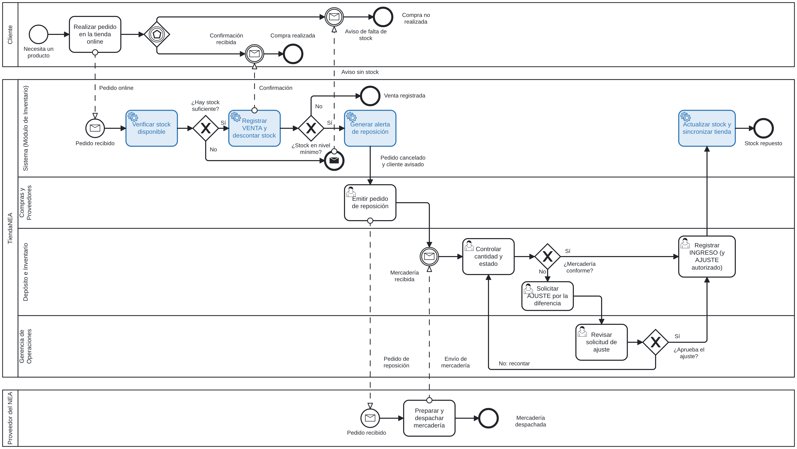

# Proceso de gestión de stock (BPMN 2.0)

Situación propuesta (TO-BE): desde el pedido online hasta la reposición de mercadería.

- **Pools:** Cliente, TiendaNEA y Proveedor del NEA (se comunican solo con flujos de mensaje).
- **Lanes de TiendaNEA:** Sistema (Módulo de Inventario), Compras y Proveedores, Depósito e Inventario y Gerencia de Operaciones.
- **Compuertas:** ¿Hay stock suficiente?, ¿Stock en nivel mínimo?, ¿Mercadería conforme?, ¿Aprueba el ajuste? (exclusivas) y una compuerta basada en eventos en el pool del Cliente.

El archivo `proceso-gestion-stock.bpmn` se puede abrir y editar en [bpmn.io](https://demo.bpmn.io/) o en Camunda Modeler.
